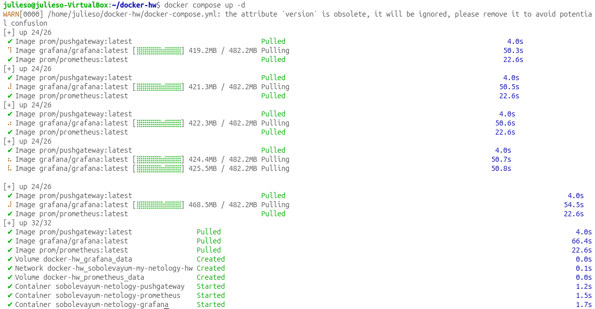
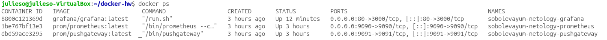
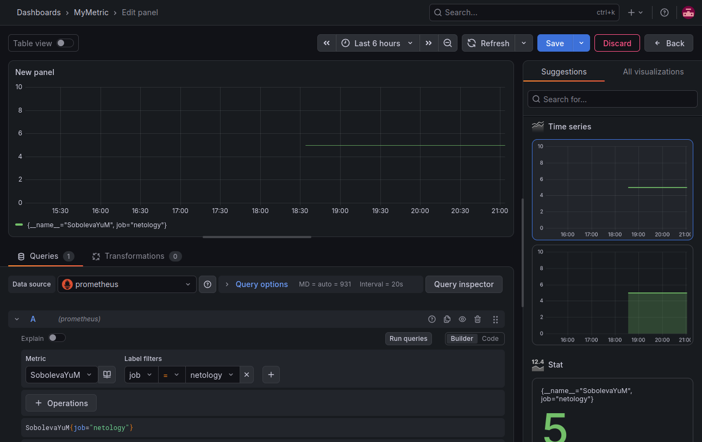
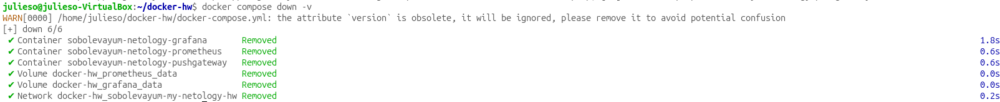
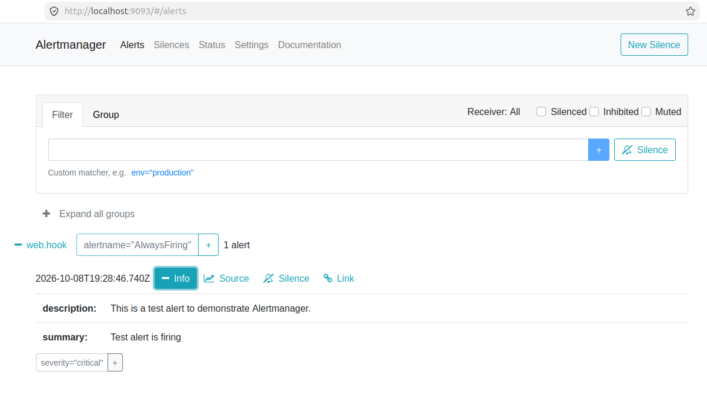

# Домашнее задание к занятию "Docker. Часть 2" - Соболева Юля

### Задание 1

**Docker Compose** — это инструмент для определения и запуска многоконтейнерных приложений с помощью единого YAML-файла. Вместо того, чтобы вручную запускать каждый контейнер с десятками флагов, мы описываем всю инфраструктуру (сервисы, сети, тома) в одном файле и управляем ею одной командой `docker compose up`. Это упрощает жизнь тем, что можно быстро развернуть целый стек (например, Prometheus + Grafana + Pushgateway) на любой машине, не запоминая параметры каждого контейнера, а просто скопировав `docker-compose.yml`. Это экономит время и исключает ошибки ручного запуска.

---

### Задание 2

```yml
version: '3.8'

services:
   # Сервисы будут добавлены позже

volumes:
   prometheus_data: {}
   grafana_data: {}

networks:
   sobolevayum-my-netology-hw:
      driver: bridge
      ipam:
         config:
            - subnet: 10.5.0.0/16
```

---

### Задание 3

```yml
prometheus:
   image: prom/prometheus:latest
   container_name: sobolevayum-netology-prometheus
   restart: always
   depends_on:
      - pushgateway
   volumes:
      - ./prometheus:/etc/prometheus:ro
      - prometheus_data:/prometheus
   command:
      - "--config.file=/etc/prometheus/prometheus.yml"
      - "--storage.tsdb.path=/prometheus"
   ports:
      - "9090:9090"
   networks:
      - sobolevayum-my-netology-hw
```

---

### Задание 4

```yml
   pushgateway:
      image: prom/pushgateway:latest
      container_name: sobolevayum-netology-pushgateway
      restart: always
      ports:
         - "9091:9091"
      networks:
         - sobolevayum-my-netology-hw
```

---

### Задание 5

```yml
   grafana:
      image: grafana/grafana:latest
      container_name: sobolevayum-netology-grafana
      restart: always
      depends_on:
         - prometheus
      volumes:
         - grafana_data:/var/lib/grafana
         - ./grafana:/etc/grafana
      environment:
         - GF_PATHS_CONFIG=/etc/grafana/grafana.ini
      ports:
         - "80:3000"
      networks:
         - sobolevayum-my-netology-hw
```

---

### Задание 6

```yml
version: '3.8'

services:
   prometheus:
      image: prom/prometheus:latest
      container_name: sobolevayum-netology-prometheus
      restart: always
      depends_on:
         - pushgateway
      volumes:
         - ./prometheus:/etc/prometheus:ro
         - prometheus_data:/prometheus
      command:
         - "--config.file=/etc/prometheus/prometheus.yml"
         - "--storage.tsdb.path=/prometheus"
      ports:
         - "9090:9090"
      networks:
         - sobolevayum-my-netology-hw

   pushgateway:
      image: prom/pushgateway:latest
      container_name: sobolevayum-netology-pushgateway
      restart: always
      ports:
         - "9091:9091"
      networks:
         - sobolevayum-my-netology-hw

   grafana:
      image: grafana/grafana:latest
      container_name: sobolevayum-netology-grafana
      restart: always
      depends_on:
         - prometheus
      volumes:
         - grafana_data:/var/lib/grafana
         - ./grafana:/etc/grafana
      environment:
         - GF_PATHS_CONFIG=/etc/grafana/grafana.ini
      ports:
         - "80:3000"
      networks:
         - sobolevayum-my-netology-hw

volumes:
   prometheus_data: {}
   grafana_data: {}

networks:
   sobolevayum-my-netology-hw:
      driver: bridge
      ipam:
         config:
            - subnet: 10.5.0.0/16
```
Запуск в detached режиме: `docker compose up -d`



---

### Задание 7

Полный текст `docker-compose.yml`

```yml
version: '3.8'

services:
   prometheus:
      image: prom/prometheus:latest
      container_name: sobolevayum-netology-prometheus
      restart: always
      depends_on:
         - pushgateway
      volumes:
         - ./prometheus:/etc/prometheus:ro
         - prometheus_data:/prometheus
      command:
         - "--config.file=/etc/prometheus/prometheus.yml"
         - "--storage.tsdb.path=/prometheus"
      ports:
         - "9090:9090"
      networks:
         - sobolevayum-my-netology-hw

   pushgateway:
      image: prom/pushgateway:latest
      container_name: sobolevayum-netology-pushgateway
      restart: always
      ports:
         - "9091:9091"
      networks:
         - sobolevayum-my-netology-hw

   grafana:
      image: grafana/grafana:latest
      container_name: sobolevayum-netology-grafana
      restart: always
      depends_on:
         - prometheus
      volumes:
         - grafana_data:/var/lib/grafana
         - ./grafana:/etc/grafana
      environment:
         - GF_PATHS_CONFIG=/etc/grafana/grafana.ini
      ports:
         - "80:3000"
      networks:
         - sobolevayum-my-netology-hw

volumes:
   prometheus_data: {}
   grafana_data: {}

networks:
   sobolevayum-my-netology-hw:
      driver: bridge
      ipam:
         config:
            - subnet: 10.5.0.0/16
```
Скриншот команды `docker ps` после запуска `docker-compose.yml`



Скриншот графика, построенного на основе моей метрики



---

### Задание 8



---

### Задание 9

Скриншот с событием из `Alertmanager`



---

### Задание 10

**Процесс развертывания**: На чистой машине без предзагруженных образов я сначала устанавливаю Docker и Docker Compose, затем копирую `docker-compose.yml` и конфигурационные файлы, и запускаю `docker compose up -d`. Docker автоматически скачивает нужные образы из Docker Hub и поднимает все сервисы согласно зависимостям.

**Зачем нужен такой способ**: Этот подход обеспечивает воспроизводимость — одна и та же конфигурация работает на любой машине с Docker: будь то локальная разработка, тестовый стенд или продакшн. Он также упрощает миграцию и масштабирование, так как вся инфраструктура описана декларативно.